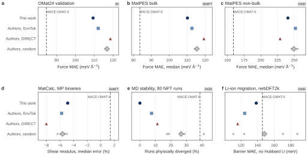
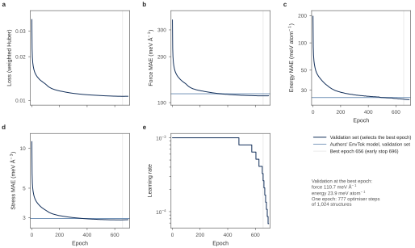
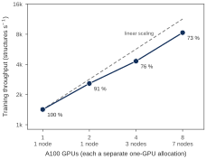
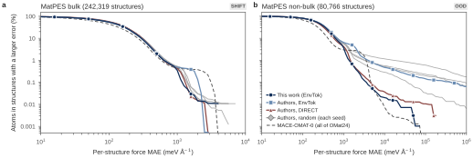
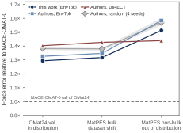
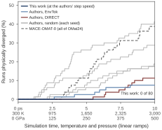
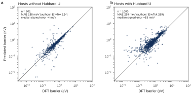
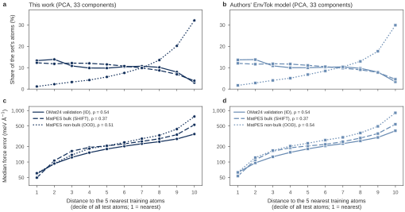

# MACE-Envtok

[](https://github.com/E1582271-dotcom/MACE-Envtok/actions/workflows/tests.yml)
[](https://github.com/E1582271-dotcom/MACE-Envtok/actions/workflows/lint.yml)
[](pyproject.toml)
[](LICENSE)
[](https://arxiv.org/abs/2610.14392)

This repository is a from-scratch PyTorch implementation of the MACE equivariant
interatomic potential. It is trained with multi-node distributed data parallel
(DDP) on the EnvTok subset of OMat24, which is 795,721 structures and about 6.6M
atoms, less than 1 % of the dataset. It reproduces the EnvTok model of Moerman
et al., *Atoms that Matter* ([arXiv:2610.14392](https://arxiv.org/abs/2610.14392)),
and evaluates it on every benchmark of the paper.

<p align="center">
  
</p>

*This work against the authors' released subset models on six benchmarks.
MACE-OMAT-0, trained on all of OMat24, is the dashed reference. The grey dots
are the authors' four random-subset seeds. The tags give the test data's
distance from the training data: in distribution (ID), dataset shift, or out of
distribution (OOD).*

- **The model is written from scratch**, using e3nn and cuEquivariance only for
  equivariant primitives. With the same weights it matches the reference
  mace-torch to 1e-13 in float64 ([docs/PARITY.md](docs/PARITY.md)).
- **It was trained on 8 A100 GPUs spread over 7 nodes**: 22 h, 176 GPU-hours,
  early stop at epoch 696.
  - Losses are normalised across all ranks, so 8 GPUs give the same updates as
    one GPU with 8-step gradient accumulation (1.5e-8 relative).
  - A run can resume on a different number of GPUs.
- **Accuracy on held-out OMat24 data is at or slightly above the authors' own
  EnvTok model**: force MAE 109.4 against 112.1 meV/Å.
- **Out of distribution, its MD runs never diverge**: 0 of 80, against 6 for the
  authors' EnvTok model and 31 for MACE-OMAT-0. On MatPES it has three times
  fewer atoms with force errors above 10 eV/Å than the authors' EnvTok model
  (1,481 against 4,693).
- **Every benchmark pipeline was validated first against the authors'
  published results.** Rerunning their models reproduces their per-structure
  values: MatCalc to 2e-10 relative, MatPES per-atom force errors to a median
  of 1.5e-6 eV/Å.

Each subset has one training run here and one from the authors. Differences
between the two EnvTok models are reported, but one run on each side is not
enough to attribute them.

## Contents

- [Training](#training)
- [Results](#results)
  - [OMat24 validation](#omat24-validation-in-distribution)
  - [MatPES](#matpes-dataset-shift-and-out-of-distribution)
  - [MatCalc-Bench](#matcalc-bench-materials-properties)
  - [MD stability](#md-stability)
  - [Li-ion migration barriers](#li-ion-migration-barriers-nebdft2k)
  - [Error and distance from the training data](#error-and-distance-from-the-training-data)
- [Trained model](#trained-model)
- [What is implemented](#what-is-implemented)
- [Reproduce](#reproduce)
- [Repository layout](#repository-layout)
- [Citation](#citation) · [Acknowledgements](#acknowledgements) · [License](#license)

## Training

The model is a MACE-OMAT-0 medium architecture trained from random
initialisation with the paper's settings:

- loss: Huber loss on energy, forces and stress with weights 1 / 10 / 10;
- optimiser: AMSGrad, lr 1e-3, EMA 0.999;
- global batch: 1,024 structures;
- early stopping: patience 40.

The cluster's whole 4-GPU nodes were rarely free. So the job asks for eight
single-GPU allocations anywhere on the machine and starts one process per GPU
with PBS's task manager. NCCL runs over TCP on the Slingshot interfaces
([docs/NSCC.md](docs/NSCC.md)).

<p align="center">
  
  
</p>

*Left: validation error on the 10 % subset used for early stopping. Our model
passes the authors' EnvTok model on the same frames at epoch 346 (forces) and
496 (energies). Right: throughput from 1 to 8 GPUs, each a separate allocation
(7 nodes at 8 GPUs); the efficiency relative to linear scaling is printed at
each point.*

On one A100 with the same cuEquivariance kernels, a training step of this
implementation reaches 94 % of the throughput of mace-torch: 1,389 against
1,470 structures/s at 128 structures per step
([results/benchmarks/speed_a100_val_r300s.jsonl](results/benchmarks/speed_a100_val_r300s.jsonl)).

## Results

The comparison models are the authors' released ones, scored by the same code
as ours. Every number here comes from a file in [results/](results), and
`envtok-mace figures` redraws every figure from those files.

### OMat24 validation (in distribution)

These 591,981 validation frames were used neither for training nor for model
selection. The table gives the MAE in meV/atom, meV/Šand meV/ų.

| Model | Training data | Energy | Force | Stress |
|---|---|---|---|---|
| **This work, EnvTok subset** | 795,721 structures | **24.59** | **109.4** | **2.879** |
| Authors, EnvTok subset | same | 25.47 | 112.1 | 2.946 |
| Authors, random subsets (4 seeds) | same size | 26.69 ± 0.17 | 116.8 ± 0.7 | 3.08 |
| Authors, DIRECT subset | same size | 28.67 | 118.6 | 3.125 |
| MACE-OMAT-0 | all of OMat24 | 17.47 | 84.5 | 2.577 |

The authors selected their models on the full validation set, which contains
these frames, so this comparison favours them.

### MatPES (dataset shift and out of distribution)

MatPES PBE 2025.2 is a different dataset: 323,096 structures, binned as in the
paper. The bulk structures resemble the training data. The non-bulk structures,
cells with a periodic dimensionality below 3, lie outside it. The table gives the
per-structure force MAE in meV/Å, as median / pooled mean.

| Model | Bulk (242,319) | Non-bulk (80,766) |
|---|---|---|
| **This work** | **110.1** / **143.3** | 240.4 / 320.8 |
| Authors, EnvTok | 112.6 / 148.6 | 251.7 / 3,904 |
| Authors, random (4 seeds) | 114.2–115.9 / 149.7–151.7 | 246.2–254.6 / 1,126–137,634 |
| Authors, DIRECT | 119.3 / 151.2 | 228.7 / 327.1 |
| MACE-OMAT-0 | 83.6 / 126.4 | 158.9 / 275.4 |

<p align="center">
  
</p>

*The tail of the error distribution: the share of atoms in structures whose
force MAE exceeds the value on the x axis. On non-bulk structures, the authors'
EnvTok model and the random seeds keep a long tail of structures where the
forces blow up. This work and DIRECT have far fewer.*

The pooled non-bulk mean is set by these few structures. Across the four random
seeds it varies more than 100-fold, so the medians are the comparable numbers.
Rescoring the authors' EnvTok model with this pipeline reproduces their
published per-atom errors, with a median difference of 1.5e-6 eV/Å
([docs/MATPES.md](docs/MATPES.md)).

<p align="center">
  
</p>

*Every subset model falls further behind the full-data model as the test data
move away from the training distribution. For this work the force error goes
from 1.29× MACE-OMAT-0 to 1.32× and then 1.51×.*

### MatCalc-Bench (materials properties)

The table gives median errors against DFT. The formation energy is given as the
paper's MAE.

| Model | E_form MAE (meV/atom) | Bulk modulus | Shear modulus | C_V (300 K) | Force softening |
|---|---|---|---|---|---|
| **This work** | 62.9 | **+1.4 %** | −4.9 % | +0.41 % | 3.6 % |
| Authors, EnvTok | 62.7 | +1.5 % | −5.8 % | +0.52 % | 3.8 % |
| Authors, random (4 seeds) | 65.5 | +2.7 % | −5.6 % | +0.38 % | 3.3 % |
| Authors, DIRECT | 74.3 | +2.0 % | −8.0 % | +0.44 % | 3.9 % |
| MACE-OMAT-0 | 56.0 | +3.2 % | +1.4 % | +0.13 % | 2.4 % |

### MD stability

The test runs 80 NPT simulations from 300 K and 0 GPa to 3,000 K and 500 GPa
over 10 ps. Completion is scored at the authors' step speed, because the
protocol's wall-clock limit truncates slow runs.

| Model | Mean completion | Physically diverged |
|---|---|---|
| **This work** | **96.1 %** | **0 / 80** |
| Authors, EnvTok | 92.1 % | 6 / 80 |
| Authors, DIRECT | 92.9 % | 9 / 80 |
| Authors, random (4 seeds) | 81.1 % | 85 / 320 |
| MACE-OMAT-0 | 75.4 % | 31 / 80 |

<p align="center">
  
</p>

### Li-ion migration barriers (nebDFT2k)

The test computes 1,656 hops; the MAE is taken over converged bands. The DFT
reference is PBE without Hubbard U, while the training data use U for oxides
and fluorides of eight transition metals. Hosts that need U are therefore a
separate column.

| Model | Without U (eV) | With U (eV) |
|---|---|---|
| **This work** | 0.138 | **0.259** |
| Authors, EnvTok | 0.124 | 0.269 |
| Authors, random (4 seeds) | 0.148 ± 0.037 | 0.264 |
| Authors, DIRECT | 0.116 | 0.316 |
| MACE-OMAT-0 | 0.146 | 0.270 |

<p align="center">
  
</p>

*Without U the predicted barriers are unbiased (median error −4 meV). With U
they are systematically high (+83 meV), as expected from the mismatch in the
level of theory.*

### Error and distance from the training data

Each atom is described by the model's 256 invariant features. A PCA on 1M
training atoms keeps 33 components (95 % of the variance). Each test atom gets
its mean distance to the 5 nearest training atoms.

- **The force error rises with that distance in every test set**, from about
  60 meV/Å in the nearest tenth of atoms to 350–770 meV/Å in the farthest
  (Spearman ρ = 0.37–0.54).
- **MatPES bulk atoms are as close to the training data as validation atoms.**
  32 % of non-bulk atoms fall in the farthest tenth, against 3 % of validation
  atoms.
- **At equal distance the three sets have similar errors.** So the non-bulk
  structures are hard because their atoms lie far from anything seen in
  training.
- The authors' EnvTok model shows the same pattern.

The analysis is in [src/envtok_mace/analysis/latent.py](src/envtok_mace/analysis/latent.py),
and all benchmarks are collected by distance from the training data in
[results/tables/id_ood_summary.md](results/tables/id_ood_summary.md).

<p align="center">
  
</p>

## Trained model

The weights are attached to the
[v1.0.0 release](https://github.com/E1582271-dotcom/MACE-Envtok/releases/tag/v1.0.0)
as `mace-envtok-1.0.0.pt` (35 MB). They are the best epoch (656) of the run
above, the weights every reported number was computed with. The file uses the
e3nn backend, which needs only the base dependencies and runs on CPU:

```python
import torch
from envtok_mace.eval.run_eval import load_model
from envtok_mace.eval.ase_calc import EnvTokCalculator

model = load_model("mace-envtok-1.0.0.pt", torch.device("cpu"), torch.float64)
# on a GPU with the cueq extra installed: backend="cueq" for the fused kernels
atoms.calc = EnvTokCalculator(model, device="cpu", dtype="float64")   # any ASE Atoms
```

It covers the 68 elements left in OMat24 after removing the lanthanides and
actinides (Z = 1–56, 72–83). Its energies are on the OMat24 PBE(+U) footing,
like those of MACE-OMAT-0.

## What is implemented

| Part | Where | Checked by |
|---|---|---|
| Radial basis, Agnesi transform, cutoff, ZBL repulsion | `model/radial.py` | parity with mace-torch |
| Generalised Clebsch–Gordan coupling tensors | `model/cg.py` | equal to mace-torch's (difference 0) |
| Symmetric contraction, density-normalised interactions | `model/blocks.py` | parity, symmetry tests |
| Model, forces and stress by autograd | `model/mace.py` | finite differences, rotations |
| cuEquivariance backend (fused kernels) | `model/backends.py` | equal to the e3nn backend |
| OMat24 extraction, neighbour lists, batching | `data/` | comparison with ASE and mace-torch |
| Loss, optimiser groups, EMA | `train/loss.py`, `train/optim.py` | equal to mace-torch's loss and groups |
| DDP, load-balanced batches, gradient accumulation, exact resume | `train/` | multi-process equivalence and resume tests |
| ASE calculator; MatPES, MatCalc, MD-stability and NEB runners | `eval/`, `bench/` | rerun of the authors' models |
| Figures and their layout check | `plots/` | every figure is checked before it is saved |

All paths are under `src/envtok_mace/`. Spherical harmonics, Wigner 3j symbols
and the basic equivariant layers come from [e3nn](https://github.com/e3nn/e3nn).
The fused GPU kernels come from
[cuEquivariance](https://github.com/NVIDIA/cuEquivariance). mace-torch is used
only as a reference in the tests.

## Reproduce

```bash
uv sync                                    # Python 3.12, torch 2.7.1, e3nn 0.4.4 (+ mace-torch for tests)
uv run pytest                              # unit, parity, distributed and figure tests
uv run envtok-mace train --config configs/train/debug_cpu.yaml   # tiny end-to-end run on CPU
uv run envtok-mace figures                 # redraw every figure from results/
```

Ten tests are skipped until their inputs are present. Eight check our code
against the authors' released EnvTok model, including the parity with
mace-torch; two need the benchmark dependencies:

```bash
bash scripts/data/download_zenodo.sh local/zenodo models.zip   # the authors' models, 358 MB
uv sync --extra bench
```

The full pipeline runs on a cluster. Each step is a CLI command with a matching
job script in `scripts/nscc/`, described in [docs/NSCC.md](docs/NSCC.md):

1. Extract the EnvTok subset from OMat24: `extract`, `preprocess`.
2. Train: `train`.
3. Evaluate: `eval`, `matpes`, `matcalc`, `stability`, `nebdft2k`, `latent`.
4. Summarise: `id-ood`, `figures`.

The benchmark dependencies, pinned to the authors' versions, are the `bench`
extra: `uv sync --extra bench`. The GPU kernels are the `cueq` extra.

Training data are not redistributed. The subset is rebuilt from
[OMat24](https://huggingface.co/datasets/facebook/OMAT24) (CC BY 4.0), using the
structure ids the authors published on
[Zenodo](https://doi.org/10.5281/zenodo.23137852). The MatPES test set is rebuilt
from the [MatPES](https://huggingface.co/datasets/materialyze/matpes) release.

## Repository layout

```
src/envtok_mace/   data/ model/ train/ eval/ bench/ analysis/ plots/, and the CLI
configs/train/     training configurations (CPU debug, 8-GPU pilot, full run)
scripts/           data download and NSCC job scripts
tests/             unit, parity, distributed and figure tests; 40 OMat24 structures as fixtures
docs/              parity, cluster notes, benchmark protocols
results/           every reported number and figure, small files only
```

## Citation

If you use this code, please cite it with the metadata in
[CITATION.cff](CITATION.cff), which GitHub shows as "Cite this repository".
Please also cite the paper it reproduces:

- E. Moerman, I. Poltavsky, A. Charkin-Gorbulin, A. Tkatchenko. *Atoms that Matter:
  Largest Materials Datasets Are 99% Redundant, and Local Chemistry Can Guide the
  Required 1%.* arXiv:2610.14392 (2026).
  Code: https://github.com/em819/omat24-chemenv-subset

The other works used:

- I. Batatia et al. *MACE: Higher Order Equivariant Message Passing Neural Networks
  for Fast and Accurate Force Fields.* NeurIPS 2022. https://github.com/ACEsuit/mace
- L. Barroso-Luque et al. *Open Materials 2024 (OMat24) Inorganic Materials Dataset
  and Models.* arXiv:2410.12771 (2024).
- A. D. Kaplan et al. *A Foundational Potential Energy Surface Dataset for
  Materials (MatPES).* arXiv:2503.04070 (2025).
- MatCalc and MatCalc-Bench: https://github.com/materialsvirtuallab/matcalc
- MLIP Arena stability benchmark (RM24 structures):
  https://huggingface.co/datasets/atomind/mlip-arena
- A. Dembitskiy et al. *Benchmarking machine learning models for predicting lithium
  ion migration (LiTraj).* npj Comput. Mater. 11, 131 (2025),
  doi:10.1038/s41524-025-01571-z

## Acknowledgements

The computational work for this project was performed on resources of the
National Supercomputing Centre, Singapore (https://www.nscc.sg). The comparison
models, subset ids and benchmark results are the authors' public release on
Zenodo (CC BY 4.0).

## License

The code is released under the MIT license ([LICENSE](LICENSE)). The trained
weights are released under CC BY 4.0, like the OMat24 data they were trained on.
Datasets and third-party results keep their own licenses. The test fixtures are
OMat24 structures (CC BY 4.0).
